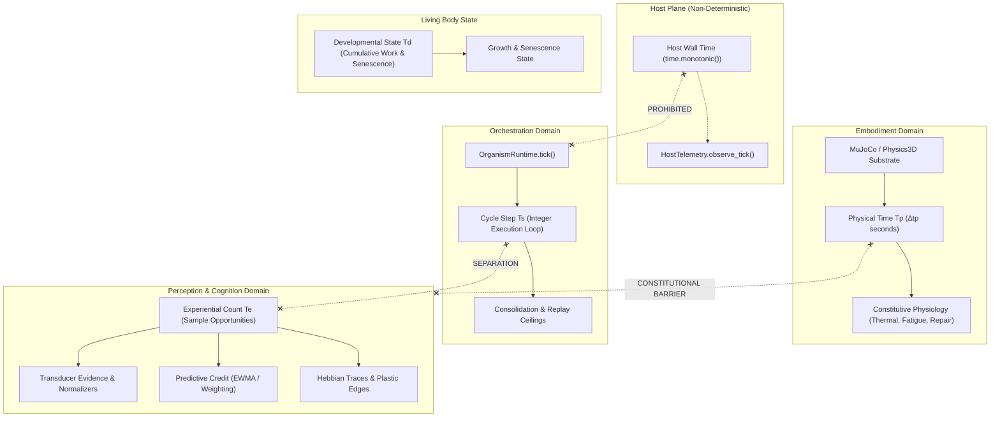

# Temporal Scales and Clock Separation v1

**State:** Reviewed / Implemented (Phase M1 Technical Baseline)  
**Date:** 2026-10-08  
**Scope:** Formal decoupling of temporal scales ($T_p, T_s, T_e, T_d$), elimination of overloaded `tick` semantics, and establishment of clock authority boundaries across the Symbiont organism runtime.  
**Authority:** Subordinate to [docs/governance/constitution.md](../../governance/constitution.md) and [docs/design/core/mathematical-foundations-and-temporal-scales-v1.md](mathematical-foundations-and-temporal-scales-v1.md).  
**Implementation State:** Implemented (Verified via G-M1.1–G-M1.7).

---

## 1. Executive Summary and Problem Statement

Phase M0 ([Mathematical Constants and Mechanisms Inventory v1](mathematical-constants-inventory-v1.md)) cataloged 76 active runtime constants and identified that the single identifier `tick` is overloaded across the codebase to mean four fundamentally distinct concepts:

1. **Physical continuous duration** ($T_p$): duration of physical simulation sub-steps and somatic dissipation ($\Delta t_p$ in seconds).
2. **Cycle / Scheduler iteration** ($T_s$): sequential integer execution step of the organism control loop (`OrganismRuntime.tick()`).
3. **Experiential event count** ($T_e$): effective observation count, evidence accumulation, and sensorimotor interaction opportunities.
4. **Developmental / Somatic history** ($T_d$): biological wear, metabolic turnover, and irreversible ontogenetic progression.

This conflation creates grave architectural and scientific failure modes:

- A change in simulation sub-stepping or scheduling cadence inadvertently accelerates or decelerates biological aging, Hebbian memory decay, and epistemic maturity.
- Somatic dissipation equations (Newton cooling, tissue repair) are discretized assuming an implicit $\Delta t_p = 1\text{ tick}$, violating physical invariance (Gate G1).
- Cognitive subsystems risk consuming raw physical durations or host wall-clock time, violating constitutional host isolation and cognitive causality.

### Cardinal Rule of Phase M1

$$\boxed{\text{M1 does not alter organism behavioral equations.}}$$
M1 is purely an **architectural typing, semantic boundary, and clock separation** milestone. If a refactoring changes temperature, fatigue, memory retention, prediction weights, or agency commitments, it has crossed into Phase M2, M3, or M4.

---

## 2. Operational Definitions of Temporal Scales

The organism recognizes four mutually incommensurable temporal scales, each with a single authoritative owner domain:

$$\begin{aligned}
T_p &\in \mathbb{R}^+ \quad [\text{seconds}] && \text{Physical duration; owned strictly by Embodiment / Physics apparatus} \\
T_s &\in \mathbb{N} \quad [\text{cycles}] && \text{Cycle / Scheduler step; owned by Organism Orchestration} \\
T_e &\in \mathbb{N} \quad [\text{observations}] && \text{Experiential evidence count; owned locally by perceptual and cognitive estimators} \\
T_d &\in \mathcal{S}_{\text{ontogeny}} && \text{Developmental state; owned by Living Body Physiology}
\end{aligned}$$

### 2.1 Physical Duration ($T_p$)
- **Definition:** The continuous metric time elapsed in the physical environment.
- **Unit:** Physical seconds $[\text{s}]$ ($\Delta t_p$).
- **Authority:** Strictly owned by **Embodiment**.
- **Constitutional Boundary:** **Strictly prohibited inside Cognition.** The cognitive graph, concept formation, prospective agency, and social relations must never inspect $T_p$, clock frequencies, or wall time. Cognition operates purely on causal sequences and experiential opportunities.

### 2.2 Cycle Step ($T_s$)
- **Definition:** The discrete integer iteration of the organism control cycle.
- **Unit:** Non-negative integers $[\text{cycles}]$.
- **Authority:** Strictly owned by **Organism Orchestration** (`OrganismRuntime`).
- **Semantics:** Monotonically increasing counter of scheduler evaluations. Governs operational cadence: structural graph consolidation intervals, episodic replay batch triggering, and checkpoint synchronization.

### 2.3 Experiential Count ($T_e$)
- **Definition:** The discrete count of actual empirical samples, transductions, or interaction opportunities observed by a specific subsystem or receptor.
- **Unit:** Integer sample count $[\text{samples}]$.
- **Authority:** Owned locally by **Perception, Sensory Systems, and Cognitive Estimators**.
- **Semantics:** $T_e \neq T_s$. A dormant or unobserved sensor experiences $\Delta T_s > 0$ while its experiential count remains $\Delta T_e = 0$. Epistemic estimators (prediction gain, credit assignment, confidence) update solely upon experiential arrival ($T_e$).

### 2.4 Developmental History ($T_d$)
- **Definition:** The irreversible ontogenetic, metabolic, and viability state of the living organism.
- **Unit:** Multidimensional biological state $\mathcal{S}_{\text{ontogeny}}$ (not a simplistic scalar clock).
- **Authority:** Owned strictly by **Living Body Physiology** (`core/embodiment/physiology.py`).
- **Architectural Boundary:** **No universal scalar `DevelopmentalTime` clock is introduced in M1.** Developmental maturity and senescence are derived somatic states shaped by cumulative metabolic work, structural wear, and tissue history. M1 formalizes the boundary; M2 and M4 will refine the specific ontogenetic estimators.

---

## 3. Subsystem Consumption and Authority Boundaries

| Subsystem | Physical $T_p$ | Cycle Step $T_s$ | Experiential $T_e$ | Developmental $T_d$ | Host Wall Time |
| :--- | :---: | :---: | :---: | :---: | :---: |
| **Physics / Embodiment** | **OWNER** (rw) | Consumer (ro) | Prohibited | Consumer (ro) | Prohibited |
| **Living Body Homeostasis** | Consumer (ro) | Consumer (ro) | Prohibited | **OWNER** (rw) | Prohibited |
| **Metabolism & Energy** | Consumer (ro) | Consumer (ro) | Prohibited | Consumer (ro) | Prohibited |
| **Organism Orchestration** | Prohibited | **OWNER** (rw) | Prohibited | Consumer (ro) | Prohibited |
| **Sensory Transducers** | Prohibited | Consumer (ro) | **OWNER** (rw) | Consumer (ro) | Prohibited |
| **Predictive Credit Assignment** | Prohibited | Prohibited | **OWNER** (rw) | Prohibited | Prohibited |
| **Cognitive Graph (Hebbian)** | Prohibited | Consumer (ro) | **OWNER** (rw) | Prohibited | Prohibited |
| **Prospective Deliberation** | Prohibited | Consumer (ro) | Consumer (ro) | Prohibited | Prohibited |
| **Social & Cultural Relations** | Prohibited | Consumer (ro) | **OWNER** (rw) | Prohibited | Prohibited |
| **Host Telemetry Adapter** | Prohibited | Prohibited | Prohibited | Prohibited | **OWNER** (isolated) |

### 3.1 Forensic Trace of Special Clocks
1. **Host Wall Time (`time.monotonic()`):**
   - *Current Path:* In [`core/orchestration/runtime.py:2187`](../../../symbiont/src/symbiont/core/orchestration/runtime.py#L2187), `tick_start = time.monotonic()` is computed and passed down to [`core/domains/lifecycle.py:191`](../../../symbiont/src/symbiont/core/domains/lifecycle.py#L191) to compute `tick_latency`.
   - *Consumer Audit:* `tick_latency` is passed exclusively to `self._host_telemetry.observe_tick(tick_latency)` in [`sensory/interoception.py:73`](../../../symbiont/src/symbiont/sensory/interoception.py#L73).
   - *Verification:* It is **never** stored in organism state, **never** exposed as an interoceptive percept, and **never** influences deterministic state. M1 formally locks this isolation: wall time remains strictly confined to host telemetry profiling.
2. **`IDLE_GRACE_TICKS = 20` in Host Self-Model:**
   - *Current Path:* [`core/cognition/host_self_model.py:27`](../../../symbiont/src/symbiont/core/cognition/host_self_model.py#L27).
   - *Consumer Audit:* Computed as `idle_ticks = max(0, current_tick - state.last_observed_tick)` (lines 131, 140, 172).
   - *Finding:* Despite the label "IDLE", this is **not** host wall time. It is literally the count of organism scheduler cycles ($T_s$) since a host capability was last sampled. M1 renames this semantically to `UNOBSERVED_CYCLES_GRACE` to prevent false wall-time inferences.

---

## 4. Forensic Classification Matrix of Current `tick` Usages

Every temporal usage across `symbiont/src/symbiont/` is classified into:

$$\text{CURRENT CLOCK} \longrightarrow \text{SEMANTIC DOMAIN} \longrightarrow \text{ALLOWED OWNER} \longrightarrow \text{M1 ACTION}$$

Where allowed `M1 ACTION` is strictly one of:
- `PRESERVE`: Valid usage of the scale; retain as canonical.
- `RENAME`: Valid semantic scale, but currently mislabeled as `tick`.
- `TYPE`: Encapsulate with explicit typed domain primitive.
- `ISOLATE`: Enforce architectural barrier preventing outward leakage.
- `DEFER_TO_M2`: Physical/somatic continuous formulation deferred to Phase M2.
- `DEFER_TO_M3`: Decay and memory kernel reformulation deferred to Phase M3.
- `DEFER_TO_M4`: Statistical maturity and epistemic estimator deferred to Phase M4.
- `REMOVE_HOST_TIME_LEAK`: Eradicate non-deterministic host timing from deterministic logic.

| Module & Location | Current Symbol / Usage | Real Semantic Domain | Allowed Owner | M1 Action | Rationale / Target Resolution |
| :--- | :--- | :--- | :--- | :--- | :--- |
| [`runtime.py:2161`](../../../symbiont/src/symbiont/core/orchestration/runtime.py#L2161) | `OrganismRuntime.tick()` | Scheduler execution cycle | Orchestration | `TYPE` | Represent cycle step as explicit `CycleStep` ($T_s$). |
| [`runtime.py:2187`](../../../symbiont/src/symbiont/core/orchestration/runtime.py#L2187) | `tick_start = time.monotonic()` | Host profiler wall clock | Host Telemetry | `ISOLATE` | Retain strictly inside host profiling; prohibit export to deterministic organism state. |
| [`homeostasis.py:108`](../../../symbiont/src/symbiont/core/embodiment/homeostasis.py#L108) | `constitutive_step()` | Somatic continuous advance | Embodiment | `DEFER_TO_M2` | Somatic integration must take $\Delta t_p$ in M2; M1 documents the interface requirement without altering Euler steps yet. |
| [`physiology_config.py:40`](../../../symbiont/src/symbiont/core/embodiment/physiology_config.py#L40) | `aging_ticks = 16` | Chronological ontogenetic cadence | Physiology | `DEFER_TO_M2` | Conflates $T_s$ with ontogeny; defer replacement by metabolic/turnover state to M2. |
| [`physiology_config.py:45`](../../../symbiont/src/symbiont/core/embodiment/physiology_config.py#L45) | `senescence_start_ticks = 2048` | Biological senescence onset | Physiology | `DEFER_TO_M2` | Uses $T_s$ for somatic degradation; defer to M2 somatic wear integration. |
| [`physiology.py:129`](../../../symbiont/src/symbiont/core/embodiment/physiology.py#L129) | `LivingBodyState.age_ticks` | Biological body lifespan | Physiology | `TYPE` / `ISOLATE` | Body-local biological cycle count ($T_s^{\text{body}}$), independent of Symbiont persistent tick; preserve behavior and defer replacement by continuous wear state to M2. |
| [`limits.py:20`](../../../symbiont/src/symbiont/cognition/limits.py#L20) | `consolidation_interval_ticks = 32` | Structural graph maintenance cadence | Cognition | `PRESERVE` | Legitimate usage of $T_s$; keep as cycle interval. |
| [`structure.py:474`](../../../symbiont/src/symbiont/cognition/structure.py#L474) | `edge.age_ticks` | Tentative edge lifespan | Cognition | `PRESERVE` | Edge lifecycle age in $T_s$ (`edge.age_ticks += 1` on each lifecycle check); defer co-activation opportunity count to M4. |
| [`sensor.py:30`](../../../symbiont/src/symbiont/sensory/sensor.py#L30) | `sensor.age_ticks` | Transducer sample history | Sensory | `DEFER_TO_M4` | Increments only when readings exist across all sources (`system.py:295`). Epistemic maturity proxy; defer replacement by sample count $N_{\text{eff}}$ to M4. |
| [`sensor.py:157`](../../../symbiont/src/symbiont/sensory/sensor.py#L157) | `self.age_ticks / 16.0` | Heuristic maturity factor | Sensory | `DEFER_TO_M4` | Conflates registration cycles with epistemic confidence; defer to M4. |
| [`predictive_credit.py:11`](../../../symbiont/src/symbiont/sensory/predictive_credit.py#L11) | `_SELECTION_FORGETTING = 0.97` | Geometric weight discount per step | Sensory | `DEFER_TO_M3` | Defer unification with continuous $\tau$ to M3; in M1 classify as experiential step ($T_e$). |
| [`predictive_credit.py:69`](../../../symbiont/src/symbiont/sensory/predictive_credit.py#L69) | `effective_weight` accumulation | Observation arrival event | Sensory | `TYPE` | Explicitly classify as experiential arrival count $T_e$ (`EvidenceCount`). |
| [`host_self_model.py:27`](../../../symbiont/src/symbiont/core/cognition/host_self_model.py#L27) | `IDLE_GRACE_TICKS = 20` | Cycles without observation | Host Self-Model | `RENAME` | Rename to `UNOBSERVED_CYCLES_GRACE` ($T_s$) with backward-compatible alias `IDLE_GRACE_TICKS`; not host wall-time. |
| [`relations.py:40`](../../../symbiont/src/symbiont/core/social/relations.py#L40) | `freshness(current_tick, half_life=32.0)` | Social evidence recency | Social Ledger | `DEFER_TO_M3` | Actual calculation is $T_s$ (`current_tick - last_tick`); intended candidate is experiential recency $T_e?$. Defer continuous $\tau$ to M3. |
| [`culture.py:1274`](../../../symbiont/src/symbiont/modeling/culture.py#L1274) | `freshness(current_tick, half_life=32.0)` | Cultural composite retention | Modeling | `DEFER_TO_M3` | Actual calculation is $T_s$; intended candidate is experiential recency $T_e?$. Defer continuous $\tau$ to M3. |
| [`telemetry.py:183`](../../../symbiont/src/symbiont/modeling/telemetry.py#L183) | `max_age_ticks` | Telemetry buffer capacity | Telemetry | `RENAME` | Rename to `retention_cycles` ($T_s$) with backwards-compatible alias and serialization support for `max_age_ticks`. |

---

## 5. Architectural Typing and Boundary Plan for M1

Rather than creating a monolithic `foundation/time.py` that erroneously puts physical duration into the Symbiont core, M1 enforces the boundary where the concepts live:

### 5.1 Orchestration & Scheduling ($T_s$)
- **Domain:** `symbiont.core.orchestration`
- **Type Primitive:** `CycleStep(int)` (immutable, non-negative integer wrapper preventing accidental arithmetic with physical seconds or float rates).
- **Semantics:** Replaces untyped `int` in scheduling loops, consolidation intervals, and cycle-based checkpoints.

### 5.2 Perception & Evidence Arrival ($T_e$)
- **Domain:** `symbiont.sensory` and `symbiont.cognition`
- **Type Primitive:** `EvidenceCount(int)` / `SampleCount(int)`.
- **Semantics:** Represents discrete counts of empirical observations, transductions, and prediction evaluations. Independent of scheduler clock speed.

### 5.3 Physical Duration ($T_p$)
- **Domain:** `symbiont.core.embodiment`
- **Type Primitive:** Stays strictly in Embodiment. Cognition and Foundation do not import or see $T_p$.
- **Semantics:** Explicitly represents physical time steps $\Delta t_p$ in seconds for physical simulation and somatic dynamics (preparing for Phase M2).

### 5.4 Developmental State ($T_d$)
- **Domain:** `symbiont.core.embodiment.physiology`
- **Semantics:** No premature universal scalar `DevelopmentalTime` is created. `LivingBodyState` retains somatic viability attributes without pretending that biological development is a scalar counter.

---

## 6. Phase M1 Gate and Invariant Criteria

The M1 milestone is closed only when all seven invariants pass technical verification:

| Invariant Gate | Formal Condition | Verification Method |
| :--- | :--- | :--- |
| **G-M1.1: Cognitive Isolation** | $T_p \not\rightarrow \text{Cognition}$ | Static AST import check asserting no module in `symbiont.cognition` imports physical duration or physics interfaces. |
| **G-M1.2: Host Non-Leakage** | $\text{host wall-time} \not\rightarrow \text{organism state}$ | Determinism regression test asserting identical trajectory across arbitrary synthetic CPU sleep delays. |
| **G-M1.3: Scale Separation** | $T_s \neq T_e$ | Contract test demonstrating that idling cycles ($\Delta T_s > 0$) with zero observations do not advance $T_e$. |
| **G-M1.4: Checkpoint Continuity** | $\text{Restore}(\text{Snapshot}(T_s, T_e, T_d)) \equiv \text{Current}$ | Snapshot roundtrip test asserting exact preservation of all separated scale markers without loss or aliasing. |
| **G-M1.5: Deterministic Replay** | $\forall \text{seed}, \text{Run}_1 \equiv \text{Run}_2$ | Bitwise trace equality test comparing execution logs across multiple runs under identical seeds. |
| **G-M1.6: Zero Equation Drift** | $\Delta \text{behavior} \equiv 0$ | Numerical regression test verifying that all somatic, sensory, cognitive, and policy outputs remain numerically identical to the pre-M1 baseline. |
| **G-M1.7: Semantic Equivalence & Backwards Compatibility** | $\text{serialize}_{\text{before}} \leftrightarrow \text{serialize}_{\text{after}}$ | Checkpoint and payload roundtrip test proving that all typed primitives, aliases, and renamed fields maintain exact bi-directional serialization compatibility. |

---

## 7. Traceability Matrix and Verification Evidence

All seven Phase M1 invariant gates have been implemented and verified via automated contract tests in [`tests/unit/core/test_temporal_scales_m1.py`](../../../symbiont/tests/unit/core/test_temporal_scales_m1.py):

| Gate Code | Gate Name | Target Mechanism / Invariant | Verification Test | Status | Evidence Summary |
| :--- | :--- | :--- | :--- | :---: | :--- |
| **G-M1.1** | Cognitive Isolation | $T_p \not\rightarrow \text{Cognition}$ | `test_g_m1_1_cognitive_isolation_ast` | **PASSED** | Static AST inspection across all modules in `symbiont.cognition` and `symbiont.core.cognition` confirms zero imports of `PhysicalDuration`, `duration`, `mujoco`, or `physics3d`. |
| **G-M1.2** | Host Non-Leakage | $\text{wall-time} \not\rightarrow \text{state}$ | `test_g_m1_2_host_non_leakage_across_synthetic_delays` | **PASSED** | Trajectories run under arbitrary synthetic host CPU sleep delays produce bitwise-identical checkpoints (`assert ckpt1 == ckpt2`). |
| **G-M1.3** | Scale Separation | $T_s \neq T_e$ | `test_g_m1_3_scale_separation_cycle_vs_experiential` | **PASSED** | Advancing scheduler cycles ($T_s$) with zero sensor observations leaves `PairwisePredictiveEvidence.observations` ($T_e$) strictly stationary at 0 until observations arrive. |
| **G-M1.4** | Checkpoint Continuity | $\text{Restore}(\text{Snapshot}) \equiv \text{Current}$ | `test_g_m1_4_checkpoint_continuity_separated_scales` | **PASSED** | Snapshot roundtrip preserves exact values of $T_s$ (`saved_at_tick`), $T_s^{\text{body}}$ (`living_body.age_ticks`), and resumes typing without aliasing. |
| **G-M1.5** | Deterministic Replay | $\forall \text{seed}, \text{Run}_1 \equiv \text{Run}_2$ | `test_g_m1_5_deterministic_replay_trace_equality` | **PASSED** | Identical random seeds produce bitwise-identical tick results and checkpoints across independent runs. |
| **G-M1.6** | Zero Equation Drift | $\Delta \text{behavior} \equiv 0$ | `test_g_m1_6_zero_equation_drift` | **PASSED** | Predictive credit weights follow analytical geometric sum $W_k = \sum_{j=0}^{k-1} 0.97^j$ exactly ($3.822773$ at $k=4$), and host grace constant preserves $20$. |
| **G-M1.7** | Semantic Equivalence & Backwards Compatibility | $\text{serialize}_{\text{before}} \leftrightarrow \text{serialize}_{\text{after}}$ | `test_g_m1_7_semantic_equivalence_and_backwards_compatibility` | **PASSED** | `CycleStep`, `EvidenceCount`, and `PhysicalDuration` serialize seamlessly to standard JSON/integers/floats; `CommunicationTelemetry` maintains bidirectional compatibility across `retention_cycles` and legacy `max_age_ticks`. |

### Summary of Source-Level Implementation

1. **Embodiment Physical Duration ($T_p$):** Added [`symbiont.core.embodiment.PhysicalDuration`](../../../symbiont/src/symbiont/core/embodiment/duration.py), strictly confined to Embodiment.
2. **Orchestration Cycle Step ($T_s$):** Added [`symbiont.core.orchestration.CycleStep`](../../../symbiont/src/symbiont/core/orchestration/cycle.py) and typed `_tick_count` in [`OrganismRuntime`](../../../symbiont/src/symbiont/core/orchestration/runtime.py).
3. **Sensory Experiential Count ($T_e$):** Added [`symbiont.sensory.EvidenceCount`](../../../symbiont/src/symbiont/sensory/evidence.py) (and alias `SampleCount`), typed `PairwisePredictiveEvidence.observations` in [`symbiont.sensory.predictive_credit`](../../../symbiont/src/symbiont/sensory/predictive_credit.py).
4. **Host Self-Model Semantics:** Renamed `IDLE_GRACE_TICKS` to `UNOBSERVED_CYCLES_GRACE` with backward-compatible alias in [`symbiont.core.cognition.host_self_model`](../../../symbiont/src/symbiont/core/cognition/host_self_model.py).
5. **Telemetry Buffer Semantics:** Supported `retention_cycles` with bidirectional `max_age_ticks` serialization in [`symbiont.modeling.telemetry`](../../../symbiont/src/symbiont/modeling/telemetry.py).
6. **Living Body State Semantics:** Formalized Body-local biological cycle count ($T_s^{\text{body}}$) docstrings in [`LivingBodyState`](../../../symbiont/src/symbiont/core/embodiment/physiology.py).
