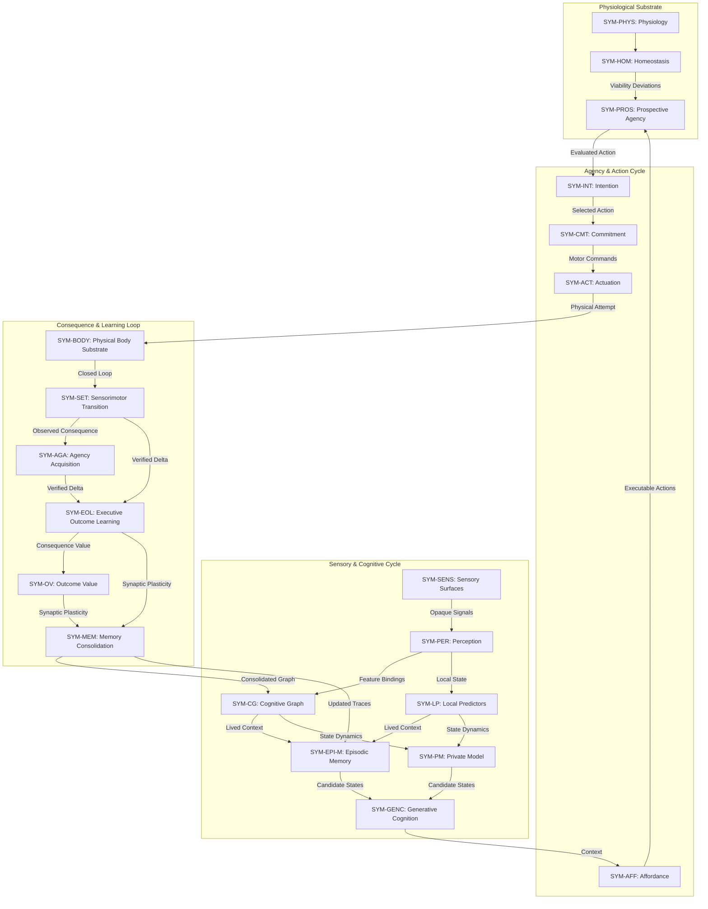

# Executive Architecture Overview

<!-- Epistemic Demarcation: Executive Synthesis Layer -->
<!-- Invariant: This document provides transversal architectural synthesis and navigation for the Symbiont system. It does not introduce new components or alter architectural invariants. Canonical authority resides in symbiont/docs/ and symbiont/docs/reference/. -->

## 1. Introduction

Symbiont is an autonomous, longitudinal digital organism whose inherited constitution, acquired cognition, agency, memory, and persistent identity remain distinct from the physical body, the environment, and the laboratory apparatus that observe or host it.

The architecture enforces strict boundaries across five repository domains:
- **`symbiont`**: Owns the subject's internal state, cognitive graph, developmental clocks, and agency.
- **`environment`**: Provides the spatial, causal environment without embedding internal organism state.
- **`embodiment`**: Implements physical kinematics, morphology, and actuation coupling without owning organism identity.
- **`modality`**: Handles sensory signal transduction between surfaces and computational channels.
- **`lab`**: Observes, records, and evaluates the subject using ground truth inaccessible to the organism.

For foundational demarcation rules, see [Foundations and Epistemology](../00-foundations-and-epistemology.md) and the reviewer guide in [quick-start.md](quick-start.md).

---

## 2. Symbiont in One Page

The organism's lifecycle and cognitive capabilities are organized across five transversal functional layers:

| Layer | Executive Architecture Definition | Primary Canonical Components |
|:---|:---|:---|
| **IDENTITY** | One continuous computational subject persisting across birth, checkpoint, restart, state restore, and physical re-embodiment without cognitive amnesia. | `SYM-LIN` (Lineage), `SYM-CHK` (Checkpoint), `SYM-LI` (Longitudinal Integrity), `SYM-LCC` (Continuity Contract) |
| **CONSTITUTION** | Genome, germline, epigenetic modulations, somatic physiology, and developmental state define biological boundaries and energetic limits — never acquired semantics. | `SYM-GEN` (Genome), `SYM-GERM` (Germline), `SYM-EPI` (Epigenetics), `SYM-ONT` (Ontogeny), `SYM-PHYS` (Physiology), `SYM-HOM` (Homeostasis) |
| **COGNITION** | Sensory surfaces, opaque signals, cognitive graph, local predictors, episodic memory, private models, and generative rollouts transform lived experience without treating hypotheses as facts. | `SYM-SENS` (Sensory), `SYM-PER` (Perception), `SYM-CG` (Cognitive Graph), `SYM-LP` (Predictors), `SYM-EPI-M` (Episodic Memory), `SYM-PM` (Private Model), `SYM-GENC` (Generative Cognition) |
| **AGENCY** | Environmental affordances, prospective evaluation, intention, motor commitment, and actuation convert learned competences into physical attempts whose consequences are observed and learned. | `SYM-COMP` (Competence), `SYM-CBIND` (Binding), `SYM-AFF` (Affordance), `SYM-PROS` (Prospective Agency), `SYM-INT` (Intention), `SYM-CMT` (Commitment), `SYM-ACT` (Actuation) |
| **CONTINUITY** | Acquired competences, autobiographical memory, identity, and longitudinal state survive morphology changes; body-specific bindings are revalidated rather than mistaken for the subject. | `SYM-EMB-H` (Embodiment History), `SYM-SET` (Transitions), `SYM-AGA` (Agency Acquisition), `SYM-EOL` (Outcome Learning), `SYM-MEM` (Memory Consolidation) |

---

## 3. Canonical Organism Flow

The diagram below synthesizes the end-to-end execution loop of the organism during an active lifecycle tick ($t \to t+1$).

It derives directly from the component contracts declared in [components.yaml](../reference/components.yaml) and the runtime choreography defined in [System and Boundaries](../01-system-and-boundaries.md):

### Flow Walkthrough

1. **Sensory Ingestion**: External physical stimuli are captured as uninterpreted, opaque sensor channels (`SYM-SENS`) and structured into perceptual percepts (`SYM-PER`).
2. **Cognitive Updating**: Perceptual bindings update the internal associative graph (`SYM-CG`) while fast local predictors (`SYM-LP`) evaluate expected sensor transitions.
3. **Internal Simulation**: Long-term episodic traces (`SYM-EPI-M`) and forward dynamics models (`SYM-PM`) feed generative rollouts (`SYM-GENC`) without confusing simulated hypotheses with reality.
4. **Action Selection**: Available environmental affordances (`SYM-AFF`) are evaluated prospectively (`SYM-PROS`) against homeostatic viability boundaries (`SYM-HOM`). The organism forms an explicit intention (`SYM-INT`) and locks in motor commitment (`SYM-CMT`).
5. **Actuation & Consequence Closure**: Motor commands are executed through somatic bindings (`SYM-ACT`). Once the physical body completes movement, the sensorimotor transition (`SYM-SET`) closes the feedback loop.
6. **Empirical Learning & Consolidation**: Agency acquisition (`SYM-AGA`) and outcome learning (`SYM-EOL`) compute prediction errors against observed consequences, generating outcome values (`SYM-OV`) that trigger long-term memory consolidation (`SYM-MEM`) into the cognitive graph and episodic store.

---

## 4. Architectural Boundaries and Registries

To inspect authoritative declarations, code links, and formal specifications, consult the reference registries:

- **Component Registry**: [components.yaml](../reference/components.yaml) — Formal definition of all 48 `SYM-*` components, state families, and authority constraints (`owns`, `may_decide`, `must_not`).
- **Parameter Registry**: [parameters.yaml](../reference/parameters.yaml) — Calibrated thresholds, learning rates, and decay constants.
- **Metric Registry**: [metrics.yaml](../reference/metrics.yaml) — Operational and longitudinal evaluation metrics across epistemic categories.
- **Notation Registry**: [notation.yaml](../reference/notation.yaml) — Disambiguated mathematical symbols.
- **Coverage Inventory**: [coverage.yaml](../coverage.yaml) — Traceability between requirements, ADRs, tests, and source code.
- **Permanent Invariants**: [docs/governance/constitution.md](../../../docs/governance/constitution.md) — Permanent architectural rules, host safety constraints, and epistemic demarcation.
