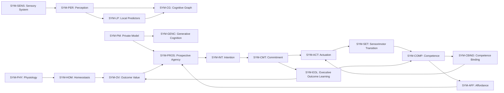

# Executive Architecture Overview

<!-- Epistemic Demarcation: Executive Synthesis Layer -->
<!-- Invariant: This document provides transversal architectural synthesis and navigation. It does not introduce new components, relations, or scientific authority. Canonical authority resides in symbiont/docs/ and symbiont/docs/reference/. -->

## 1. Introduction

Symbiont is a longitudinal computational subject whose organism-owned state, cognition, agency, memory, and identity remain distinct from the physical body, the environment, and the laboratory apparatus.

The repository is separated into five domains:
- **`symbiont`** owns organism state and mechanisms.
- **`environment`** owns external environmental state and dynamics.
- **`embodiment`** owns physical coupling and body-specific receptor/effector contracts, not organism identity.
- **`modality`** exposes bounded transduction channels.
- **`lab`** observes, records, and evaluates using information that may be inaccessible to the organism.

For the authoritative boundary model, see [System and Boundaries](../01-system-and-boundaries.md). For reading guidance, see [quick-start.md](quick-start.md).

---

## 2. Symbiont in One Page

The table below is a human-oriented grouping of canonical components. The groups are editorial synthesis only; component ownership and authority remain defined by [components.yaml](../reference/components.yaml).

| Layer | Executive Architecture Definition | Primary Canonical Components |
|:---|:---|:---|
| **IDENTITY** | Longitudinal identity, checkpoint continuity, and lineage remain organism-owned across restart and re-embodiment. | `SYM-LIN`, `SYM-CHK`, `SYM-LI`, `SYM-LCC` |
| **CONSTITUTION** | Genome, germline, epigenetic state, phenotype expression, development, physiology, and homeostasis constrain what the organism can become without embedding acquired semantics. | `SYM-GEN`, `SYM-GSC`, `SYM-GRM`, `SYM-EPI-G`, `SYM-PHEX`, `SYM-PHENO`, `SYM-DEV`, `SYM-PHY`, `SYM-HOM` |
| **COGNITION** | Sensory intake, perception, cognitive graph, predictors, episodic memory, private models, and generative processes transform organism-accessible evidence while keeping hypotheses distinct from facts. | `SYM-SENS`, `SYM-PER`, `SYM-CG`, `SYM-LP`, `SYM-PROM`, `SYM-EPI-M`, `SYM-PM`, `SYM-GENC`, `SYM-HYP`, `SYM-CF` |
| **AGENCY** | Competence, affordances, prospective agency, intention, commitment, binding, actuation, sensorimotor evidence, and outcome learning connect learned capability to physical attempts and observed consequences. | `SYM-COMP`, `SYM-CBIND`, `SYM-AFF`, `SYM-PROS`, `SYM-INT`, `SYM-CMT`, `SYM-ACT`, `SYM-SET`, `SYM-AGA`, `SYM-EOL`, `SYM-OV` |
| **CONTINUITY & LEARNING** | Memory, replay, embodiment history, metaplasticity, and longitudinal state preserve acquired organisation without treating a body-specific binding as organism identity. | `SYM-META`, `SYM-REPLAY`, `SYM-MEM`, `SYM-EMB-H`, `SYM-LI` |

---

## 3. Traceable Organism Relationship View

This diagram intentionally shows only a **selected subset of direct component relationships already declared in** [components.yaml](../reference/components.yaml). It is not a new execution specification, it omits many valid edges, and it does not imply that every relation shown executes synchronously in one tick.

The physical Body is deliberately not represented as a `SYM-*` component. Physical realization crosses the Embodiment/Body boundary described in [System and Boundaries](../01-system-and-boundaries.md).

### How to read the view

- **Perception and prediction**: `SYM-SENS` feeds `SYM-PER`; perception supplies both cognitive-graph and local-predictor consumers.
- **Prospection**: `SYM-PM`, `SYM-AFF`, and `SYM-OV` are direct inputs/consumers around `SYM-PROS`; generative cognition consumes the private model but generated hypotheses remain non-factual.
- **Executive action**: prospective agency feeds intention, intention feeds commitment, and commitment plus the current execution binding permit actuation.
- **Learning closure**: actuation is consumed by sensorimotor transition; executive outcome learning consumes commitment and observed consequence deltas, then contributes to outcome value and competence learning.
- **Embodiment boundary**: the actual physical attempt and its sensed consequences occur through Embodiment and Body. Those external entities are intentionally not relabelled as `SYM-*` components.

---

## 4. Architectural Boundaries and Registries

Authoritative declarations live in:
- **[components.yaml](../reference/components.yaml)** — all 48 `SYM-*` components, state families, lifecycle, authority, inputs, outputs, and consumers.
- **[parameters.yaml](../reference/parameters.yaml)** — canonical quantitative parameters.
- **[metrics.yaml](../reference/metrics.yaml)** — measurement semantics partitioned by epistemic class.
- **[notation.yaml](../reference/notation.yaml)** — formal symbols and forbidden meanings.
- **[coverage.yaml](../coverage.yaml)** — traceability to implementation, tests, designs, ADRs, dependencies, and Master IDs.
- **[docs/governance/constitution.md](../../../docs/governance/constitution.md)** — permanent architectural and epistemic invariants.
