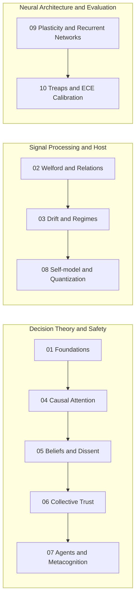

# Mathematical Compendium of Symbiont and Symbiont Lab

Welcome to the comprehensive mathematical compendium of **Symbiont** and **Symbiont Lab**.

This set of documents formalizes each algorithm, analytical deduction, statistical space, and dynamic invariant implemented in the repository or preserved for historical provenance. The documentation distinguishes active organism runtime from external scientific apparatus tools and retired pre-five-domain architectures.

---

## Editorial Framework and Epistemic Taxonomy

To guarantee maximum intellectual honesty and clearly differentiate mathematical theory from engineering practice, each chapter classifies its developments under four canonical epistemic labels:

1. **`[CODE]`:** Formulas, invariants, and algorithms that describe the execution of active production software with exact arithmetic and algorithmic precision (e.g., Welford's algorithm, EWMA drift detection, Dantzig knapsack, Oja plasticity rule, self-model logarithmic quantization).
2. **`[FORMAL]`:** Valid mathematical formalizations of current system concepts and boundary invariants that do not map 1:1 to a single execution function (e.g., deterministic non-interference invariant, bounded state manifolds).
3. **`[STUDY]`:** Mathematics belonging to the external scientific apparatus, laboratory protocols, or evaluation pipelines in the `lab` domain; does not describe organism-internal cognition (e.g., streaming causal selection via Treaps with SplitMix64).
4. **`[HISTORICAL]`:** Models, equations, or heuristic architectures from retired or superseded systems preserved for provenance (e.g., retired synthetic cyber-threat classifiers, ternary Hamming fingerprints, `MetacognitionEngine`, Brier scores over threat ground truth).

> [!IMPORTANT] Note on Historical Mathematics
> Historical mathematics is retained for provenance, archive, and design history, but is strictly excluded from claims about the current organism unless explicitly revalidated and integrated under an active architectural decision.

---

## Compendium Structure

| Chapter | Title | Canonical Status | Main Code Modules | Key Concepts |
| --- | --- | --- | --- | --- |
| **[01](01-fundamentals-and-epistemology.md)** | [Epistemological Foundations and Mathematical Framework](01-fundamentals-and-epistemology.md) | **MIXED** (`[FORMAL]` + `[CODE]` + `[HISTORICAL]` residue) | `symbiont.host.adaptive`, `environment.rng`, `lab.studies.common.rng` | Deterministic non-interference invariant, opaque sense hash (`sense_id`), RNG stream seed derivation tree, and boundary isolation. |
| **[02](02-perception-acclimation-and-relations.md)** | [Perception, Sensory Acclimation and Algebra of Relations](02-perception-acclimation-and-relations.md) | **CODE** | `symbiont.host.acclimation`, `symbiont.host.adaptive` | Univariate and bivariate Welford online algorithms (centered co-moments), lagged temporal correlations ($a_{t-1} \to b_t$), Dynamic Utility Function $U = A(0.65V + 0.35M)$, collinearity pruning ($\lvert r \rvert \ge 0.97$), and deterministic rotation with eventual coverage. |
| **[03](03-drift-detection-and-regimes.md)** | [Drift Detection, Regime Break and Rhythmic Modeling](03-drift-detection-and-regimes.md) | **CODE** | `symbiont.host.drift`, `symbiont.host.rhythms` | EWMA filter with moving heuristic dispersion, jump detector with non-contaminating quarantine buffer, divergence limit with frozen noise floor $\frac{6.667 c}{\sigma_{\text{frozen}}}$ for slow creep, and diurnal conditional baselines. |
| **[04](04-causal-attention-and-budgets.md)** | [Causal Attention Allocation and Finite Budget Optimization](04-causal-attention-and-budgets.md) | **CODE** | `symbiont.core.cognition.attention` | Dantzig's greedy heuristic $O(n \log n)$ for the 0/1 knapsack, dimensionless coefficient of variation $c_v = \sigma / \lvert \mu \rvert$, formal decoupling between ranking cost $r_i$ and physical consumption cost $k_i$, and hard budget invariance. |
| **[05](05-bayesian-beliefs-and-dissent.md)** | [Bayesian Belief Dynamics, Surprise and Dissent Logging](05-bayesian-beliefs-and-dissent.md) | **MIXED** (`[HISTORICAL]` §§1–4 + `[CODE]` §5) | `symbiont.core.cognition.evidence` | Active standardized batch discrepancy $Z_{\text{batch}}$ and circular dissent logging (`DissentRecord`); historical conjugate Beta belief model with $E_{\max}=32.0$. |
| **[06](06-collective-consensus-and-trust.md)** | [Collective Consensus, Trust Dynamics and Epigenetic Distillation](06-collective-consensus-and-trust.md) | **HISTORICAL** | *None (retired architecture)* | Retired source-reputation and collective-consensus models; active social modeling operates under `SocialEvidenceLedger` without scalar reputation. |
| **[07](07-agent-cognition-and-metacognition.md)** | [Agent Cognition, Counterfactual Curiosity and Metacognition](07-agent-cognition-and-metacognition.md) | **HISTORICAL** | *None (retired simulation stack)* | Retired cyber-agent simulator: ternary fingerprints $(L, M, H)^5$, apparent risk $R_{\text{raw}}$, combined suspicion $S_{\text{comb}}$, and `MetacognitionEngine` ($P_{\text{epistemic}}$). Active self-model lives in Ch. 08. |
| **[08](08-self-model-and-adaptive-sensors.md)** | [Organism Self-model, Costs and Non-Linear Quantization](08-self-model-and-adaptive-sensors.md) | **CODE** | `symbiont.core.cognition.self_model`, `symbiont.core.cognition.host_self_model` | EWMA with exponential decay after grace zone ($\tau=20$), logarithmic maturity function $\frac{\ln(1+s)}{\ln(6)}$, relative cost versus moving population median, and 4-bit non-linear geometric latency quantization. |
| **[09](09-endogenous-plasticity-and-recurrent-networks.md)** | [Endogenous Plasticity, Recurrent Cognitive Graphs and Activation Dynamics](09-endogenous-plasticity-and-recurrent-networks.md) | **CODE** | `symbiont.cognition.activation`, `symbiont.cognition.graph`, `symbiont.cognition.learning`, `symbiont.core.cognition.plasticity_state` | Tangential input normalization, causal delay activation dynamics with multiplicative gates, discretized Oja's learning rule (`apply_oja_update`), eligibility traces, and global invariant bounding activations in $[-1, 1]$. |
| **[10](10-causal-selection-and-statistical-evaluation.md)** | [Streaming Causal Selection, Treaps and Statistical Evaluation Metrics](10-causal-selection-and-statistical-evaluation.md) | **MIXED** (`[STUDY]` + `[CODE]` §§1–4 + `[HISTORICAL]` §§5–6) | `lab.studies.common.causal_selection` | Active streaming causal selection with ex-ante known horizon using Treap (SplitMix64) in expected $O(\log n)$; historical Brier score and threat confusion matrices. |

---

## Recommended Pedagogical Paths

Depending on the objective of the reader, the following itineraries are recommended:

- **For Designers of Agents and Epistemic Models:** Follow **Itinerary A** (Chapters 1, 4, 5, 6 and 7), paying special attention to how Bayesian beliefs handle conflict and how selective attention is decoupled from value judgments.
- **For Systems and Observability Engineers in Hosts:** Follow **Itinerary B** (Chapters 2, 3 and 8), delving into the numerical stability of Welford, the prevention of variance collapse in creep detection and the latency quantization of the self-model.
- **For Researchers of Plastic Learning and Experimental Methodology:** Follow **Itinerary C** (Chapters 9 and 10), examining the strict bounding of activations in recurrent graphs and the causal selection in streaming through Treaps without retrospective bias.

---

## Glossary of Canonical Constants and Fundamental Symbols

| Symbol | Type | Canonical Value | Module | Mathematical Meaning |
| --- | --- | --- | --- | --- |
| $B$ | Scalar | $1.0$ | `attention.py` | Hard attention budget per tick. |
| $N_{\min}$ | Integer | $5$ (or $4$ in adaptive) | `acclimation.py`, `self_model.py` | Minimum samples to declare a sensor acclimated. |
| $\lambda$ | Scalar | $0.10$ | `drift.py` | Learning rate of the baseline EWMA filter. |
| $\lambda_{\text{fast}}$ | Scalar | $0.30$ | `drift.py` | Fast learning rate for slow drift detection (*creep*). |
| $z_{\text{regime}}$ | Scalar | $2.0$ | `drift.py` | Deviation threshold for regime change candidates. |
| $z_{\text{isolated}}$ | Scalar | $3.0$ | `drift.py` | Deviation threshold to classify an isolated peak. |
| $K_{\text{regime}}$ | Integer | $3$ | `drift.py` | Minimum streak of consistent observations to confirm a regime. |
| $z_{\text{creep}}$ | Scalar | $1.0$ | `drift.py` | Divergence threshold against the frozen noise floor. |
| $K_{\text{creep}}$ | Integer | $8$ | `drift.py` | Minimum streak to confirm slow creep. |
| $E_{\max}$ | Scalar | $32.0$ | `beliefs.py` (historical) | Upper bound of evidence saturation in retired belief model. |
| $\alpha_{\text{self}}$ | Scalar | $0.06$ | `self_model.py`, `activation.py` | EWMA smoothing constant for the self-model and sensory normalizer. |
| $\tau_{\text{grace}}$ | Integer | $20$ | `self_model.py` | Grace zone (inactivity ticks before initiating decay). |
| $\theta_{\text{red}}$ | Scalar | $0.97$ | `adaptive.py` | Pearson correlation threshold to prune redundant sensors. |
| $\theta_{\text{conflict}}$ | Scalar | $2.0$ | `evidence.py` | Batch discrepancy Z-threshold to emit a `DissentRecord`. |
| $w_{\max}, w_{\min}$ | Tuple | $[-2.0, 2.0]$ | `types.py` | Closed range of synaptic weights in the cognitive graph. |
| $\tau_{\text{node}}$ | Tuple | $[0.1, 10.0]$ | `types.py` | Admissible range of the neural activation scale parameter. |
